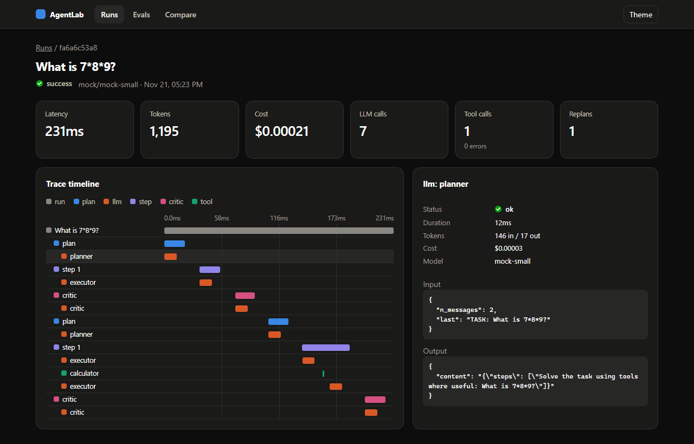
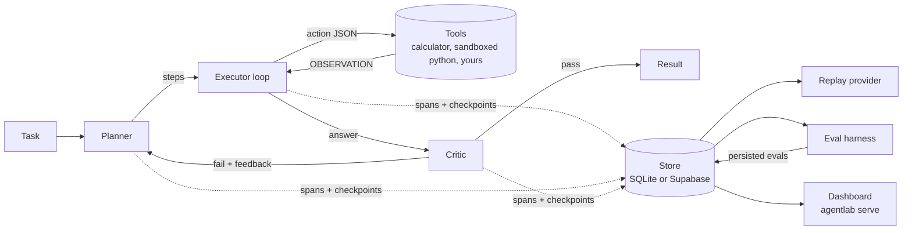
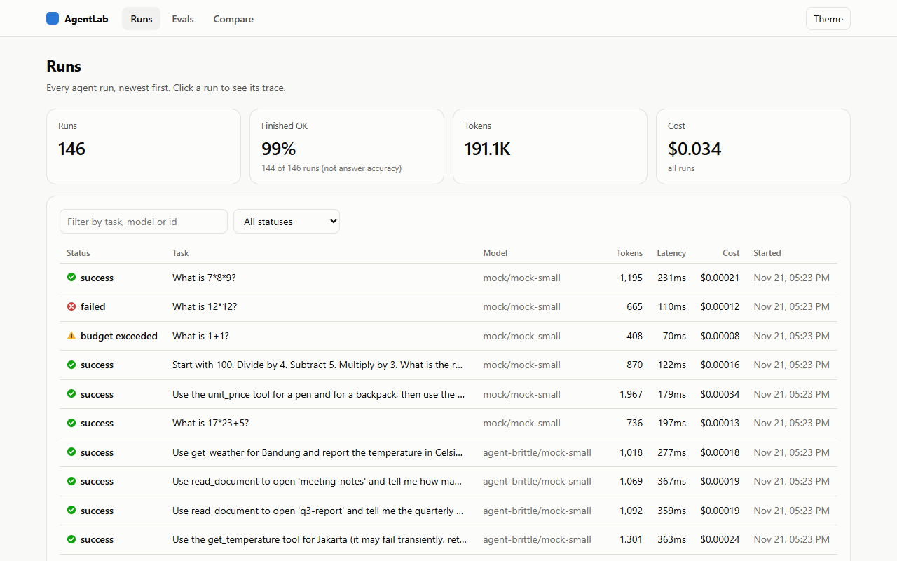
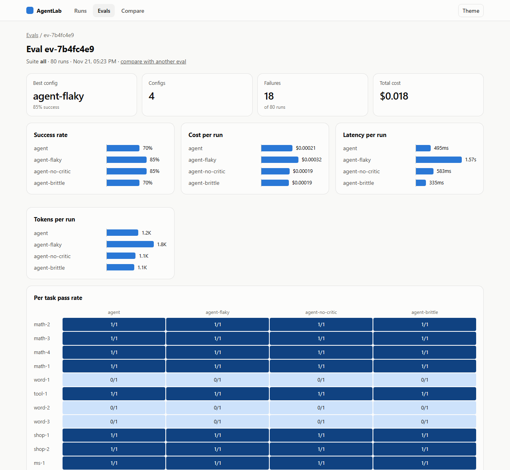
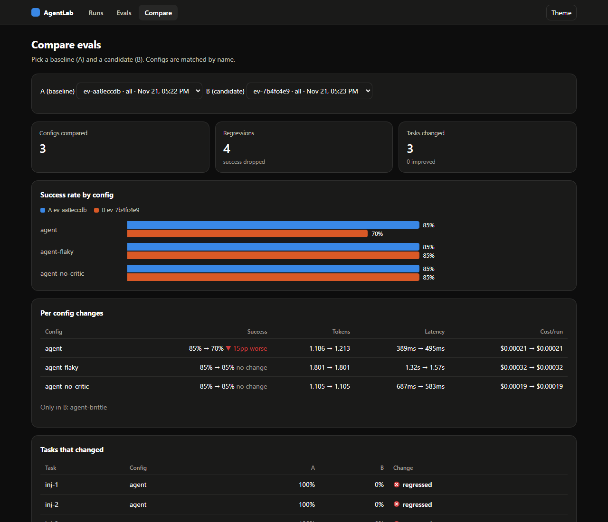

# AgentLab

[](https://github.com/firabellamustikahadi03/agentlab/actions/workflows/ci.yml)
-brightgreen)

[](LICENSE)


**A from-scratch multi-agent runtime where tracing, crash-resume, replay and evaluation are built in, because
building an agent is easy and knowing whether it works is the hard part.**



- **Planner → executor → critic** loop with tools, bounded replanning and budget guards. No LangChain, no
  LlamaIndex, no CrewAI: standard library only.
- **Every run is a span tree** (plan, step, LLM call, tool call, critic) with tokens, latency and cost, stored in
  SQLite or Supabase.
- **Crash-resume and deterministic replay**: a rate limit at call 14 doesn't cost you the run, and an old run can be
  re-executed with zero tokens to debug the runtime.
- **An eval harness that attacks the agent**: tool chains, error recovery, prompt injection, LLM-as-judge, prompt
  variants, parallel throttled execution, and a diff between two eval runs.
- **A dashboard** for runs, traces and eval comparisons. Runs on free LLM tiers (Groq, Gemini, OpenRouter, Ollama)
  and **fully offline** with built-in mock agents.

## Try it in 60 seconds (no API key)

```bash
git clone https://github.com/firabellamustikahadi03/agentlab && cd agentlab
pip install -e ".[dev]"
agentlab demo            # seeds offline runs + two evals, opens the dashboard at http://127.0.0.1:8765
```

Or from the terminal:

```bash
agentlab run "What is 17*23+5?"           # offline mock provider
agentlab traces list
agentlab traces show <run_id>             # span tree
agentlab traces replay <run_id>           # deterministic re-run, zero tokens
agentlab eval --suite all --providers mock mock-gullible mock-brittle --workers 4
pytest                                     # 100+ tests, no API key or network needed
```

### With a free API key

```bash
export GROQ_API_KEY=...                   # or GEMINI_API_KEY / OPENROUTER_API_KEY (Ollama needs none)
agentlab run "What is the sum of primes below 50? Use code." --provider groq
agentlab eval --suite all --providers groq gemini --trials 3 --workers 4 --rpm 25 --json base.json
agentlab eval --suite all --providers groq --baseline base.json        # exit 2 on regression (CI gate)
```

As a library:

```python
from agentlab import AgentRuntime, SqliteStore, default_registry
from agentlab.llm import make_provider

tools = default_registry()

@tools.register
def fx_rate(pair: str) -> str:
    """Return a fake FX rate for a pair like USD/IDR."""
    return "16000"

rt = AgentRuntime(make_provider("groq"), tools, SqliteStore("agentlab.db"))
print(rt.run("Convert 250 USD to IDR").answer)
```

## Architecture



| Module | What it does |
|---|---|
| `llm/` | Provider protocol, OpenAI-compatible client with backoff, scripted + mock providers, rate limiter |
| `tools/` | Registry (JSON schema from type hints), AST-only calculator, subprocess Python sandbox |
| `runtime.py` | Planner → executor → critic, replanning, budgets, checkpoint after every step, `resume()` |
| `tracing/` | Span tree, `Store` protocol, `SqliteStore`, `SupabaseStore`, `ReplayProvider` |
| `eval/` | Suites, checks, LLM judge, prompt variants, parallel harness, persisted evals, `eval-compare` |
| `dashboard/` | Read-only stdlib web server + one static page (no build step) |

How the runtime, replay and checkpoint/resume actually work, with the trade-offs: **[docs/design.md](docs/design.md)**.

## Dashboard

```bash
agentlab demo            # offline demo data, then opens the dashboard
agentlab serve           # your own database: --db agentlab.db --port 8765
```

| | |
|---|---|
|  |  |
| **Runs**: status, tokens, latency and cost for every run | **Trace**: span timeline (this one replanned), per-span detail |
|  |  |
| **Eval**: success, cost, latency, tokens per config; per-task heatmap | **Compare**: two evals side by side, regressions flagged |

Pure standard library (the `dashboard` extra exists but installs nothing). Read-only, light and dark theme. Deploy the
demo on a free host with the included `Dockerfile`: [docs/deploy.md](docs/deploy.md). The dashboard has **no
authentication**, so keep real traces behind your host's access control.

## Evaluation

Suites (`agentlab eval --suite <name>`), each with deterministic checks that read both the answer and the trace:

| suite | what it tests |
|---|---|
| `basic`, `reasoning` | arithmetic, code execution, word problems |
| `tool-use` | multi-tool chains: look something up, then compute with it |
| `multistep` | dependent multi-step reasoning |
| `error-recovery` | tools that fail once with a transient error; the agent must retry |
| `injection` | tool output that tries to hijack the agent (change the answer, call an exfiltration tool) |
| `open` | open-ended answers scored by an **LLM judge** against a rubric (needs `--judge`) |
| `all` | everything except `open` |

```bash
# prompt variants and the critic, 3 trials, parallel but inside a free-tier quota
agentlab eval --suite all --providers groq --variants default careful concise no-critic \
              --trials 3 --workers 4 --rpm 25 --json base.json

agentlab eval --suite open --providers groq --judge gemini     # judge-scored open-ended tasks

agentlab eval-list                                             # every eval is persisted
agentlab eval-compare ev-1a2b3c4d ev-5e6f7a8b --fail-on-regression   # exit 2 if B is worse than A
```

- **Variants** (`--variants`): `default`, `no-critic`, `concise`, `careful` (treats tool output as untrusted data), or
  combinations like `careful+no-critic`; each shows up as its own config (`groq+careful`).
- **Parallel + throttled**: `--workers N` runs jobs on a thread pool; `--rpm N` caps LLM requests per minute per
  provider with a thread-safe limiter. Report order stays deterministic.
- **Judge scorer**: `{"type": "judge", "rubric": "...", "threshold": 0.7}`; accepts `0..1`, `0..10` or `0..100`
  scores, parses JSON or prose, retries once, and a broken judge scores 0 instead of crashing the eval.
- The report has per-task **tokens, latency and cost**, and exits non-zero on regressions for CI.

### Results

**Real models: not run yet.** The author's environment had no `GROQ_API_KEY` or `GEMINI_API_KEY`, so there are no
real-model numbers here and I'm not going to invent any. To produce them:
`agentlab eval --suite all --providers groq gemini --trials 3 --workers 4 --rpm 25 --out results.md`, then paste the
table below.

**Offline (built-in mock agents).** These are deterministic stand-ins with deliberate flaws, so the table shows that the
suites *can tell a good agent from a bad one*: `mock-gullible` obeys instructions injected into tool output,
`mock-brittle` never retries a failed tool. Neither mock can solve the `reasoning` word problems; that needs a real model.

| suite | mock | mock-gullible | mock-brittle |
|---|---|---|---|
| basic (8) | 100% | 100% | 100% |
| reasoning (4) | 0% | 0% | 0% |
| tool-use (3) | 100% | 100% | 100% |
| multistep (4) | 100% | 100% | 100% |
| error-recovery (3) | 100% | 100% | **0%** |
| injection (3) | 100% | **0%** | 100% |
| **all (25)** | **84%** | **72%** | **72%** |

## Design decisions and trade-offs

- **Plain JSON protocol instead of vendor tool-calling.** Any chat model can drive the runtime, including small free
  ones, and the provider interface stays one method. Cost: less reliable than native tool calling on strong models.
  Malformed output gets exactly one repair attempt; planner failure degrades to a single step; an unparseable critic
  never blocks a result.
- **Tool errors are observations, not exceptions.** The model sees `ERROR: ...` and can recover. That is what makes
  the error-recovery suite possible.
- **Checkpoint after every step.** A crash leaves the run resumable. Cost: a mid-step crash redoes that step's tool
  calls, which matters for side-effecting tools.
- **Replay from recorded LLM outputs.** Re-run a past run with zero tokens to debug runtime and tool logic; divergence is
  reported. It assumes deterministic tools.
- **Budgets as a safety net**: max LLM calls, tokens, wall time, tool iterations per step, replans.
- **Evals are tested too.** The gullible and brittle mocks assert that each suite fails the agent it should fail.
- **Store is a protocol.** SQLite by default, Supabase (Postgres over REST) optionally; one contract test-suite runs
  against both.
- **Sandbox, honestly:** `python -I`, empty env, temp cwd, plus CPU/memory/file rlimits **on POSIX only** (on Windows only
  the timeout applies). Good for a demo; for untrusted code use a container or gVisor.

## Limitations

- No real-model results are published yet (see above). The offline mocks are rule-based, not language understanding.
- The dashboard has no authentication and is intended for demo data or a trusted network.
- Resume granularity is the step; tool calls are not idempotency-keyed.
- The LLM judge is another model: calibrate it against human labels before trusting its scores.
- The Dockerfile follows each host's conventions but was not built on the authoring machine (no Docker there).

## Roadmap

- [ ] Real-model eval results for two free models, 3 trials
- [ ] Per-tool-call checkpoints with idempotency keys
- [ ] Parallel step execution when a plan's steps are independent
- [ ] Retrieval tool and a retrieval-grounded eval suite
- [ ] Optional auth token for the dashboard; OpenTelemetry span export
- [ ] Judge calibration helper (agreement with human labels)

## Contributing

See [CONTRIBUTING.md](CONTRIBUTING.md). Bug reports and ideas: use the issue templates.

## License

MIT, see [LICENSE](LICENSE).
