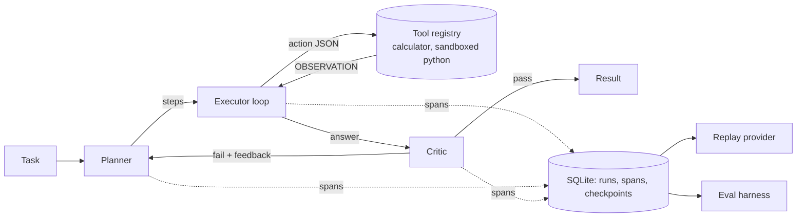

# AgentLab

A multi-agent runtime built **from scratch** (no LangChain / LlamaIndex / CrewAI), with hierarchical tracing,
deterministic replay, crash-resume, and an automatic evaluation harness. Standard library only. Runs on free LLM tiers
(Groq, Gemini, OpenRouter, Ollama) and fully offline with a built-in mock provider.

The point of the project: building an agent is easy, **knowing whether it works** is the hard part.
AgentLab treats tracing and evaluation as first-class parts of the runtime.

## Architecture



| Module | What it does |
|---|---|
| `llm/` | Provider protocol, OpenAI-compatible client with backoff for 429s, scripted + mock providers |
| `tools/` | Registry (JSON schema from type hints), AST-only calculator, subprocess python sandbox with rlimits |
| `runtime.py` | Planner → executor → critic, replanning, budget guards, checkpoint after every step, `resume()` |
| `tracing/` | Span tree (run > plan/step > llm/tool/critic) with tokens, latency, cost; `ReplayProvider` |
| `eval/` | Tasks × configs × trials, scorers, markdown/JSON report, regression gate |

## Design decisions

- **Plain JSON protocol instead of vendor tool-calling.** Any chat model can drive the runtime, including small free ones.
  Malformed output gets one automatic repair attempt; planner failure degrades to a single-step plan; an unparseable critic never blocks a result.
- **Tool errors are observations, not exceptions.** The model sees `ERROR: ...` and can recover (unknown tool, bad args, timeout).
- **Checkpoint after every step.** A crash (network, rate limit) leaves the run resumable; `resume` skips completed steps.
- **Replay from recorded LLM outputs.** Re-run a run with zero tokens spent to debug runtime/tool logic; divergence is reported.
- **Budgets as a safety net.** Max LLM calls, tokens, wall time, tool iterations per step, replans.
- **Sandbox, honestly:** `python -I`, empty env, temp cwd, CPU/memory/file rlimits. Good for a demo; for untrusted code use a container/gVisor.

## Quickstart

```bash
pip install -e ".[dev]"
pytest                                   # 14 tests, no API key needed

agentlab run "What is 17*23+5?"          # offline mock provider
agentlab traces list
agentlab traces show <run_id>            # span tree
agentlab traces replay <run_id>          # deterministic re-run

export GROQ_API_KEY=...                  # or GEMINI_API_KEY / OPENROUTER_API_KEY
agentlab run "What is the sum of primes below 50? Use code." --provider groq
agentlab eval --suite all --providers groq gemini --trials 3 --sleep 2 --json base.json --out report.md
agentlab eval --suite all --providers groq --baseline base.json   # exit 2 on regression
```

Use it as a library:

```python
from agentlab import AgentRuntime, SqliteStore, default_registry
from agentlab.llm import make_provider

tools = default_registry()

@tools.register
def fx_rate(pair: str) -> str:
    """Return a fake FX rate for a pair like USD/IDR."""
    return "16000"

rt = AgentRuntime(make_provider("groq"), tools, SqliteStore("agentlab.db"))
print(rt.run("Convert 250 USD to IDR").answer)
```

## Example eval output (offline mock, shows the report format)

| config | runs | success | avg tokens | llm calls | replan |
|---|---|---|---|---|---|
| mock | 12 | 67% | 841 | 4.0 | 0% |
| mock-flaky | 12 | 67% | 1380 | 7.0 | 100% |

Replace with real numbers from Groq/Gemini once you run `agentlab eval` with your keys.

## Limitations / next steps

- Phase 2: more suites, LLM-as-judge scorer, per-task cost/latency charts.
- Phase 3: web dashboard (trace timeline, eval comparison), Supabase store, free-tier deploy.
- Phase 4: parallel step execution, retrieval tool, prompt-injection test suite for the agent itself.
