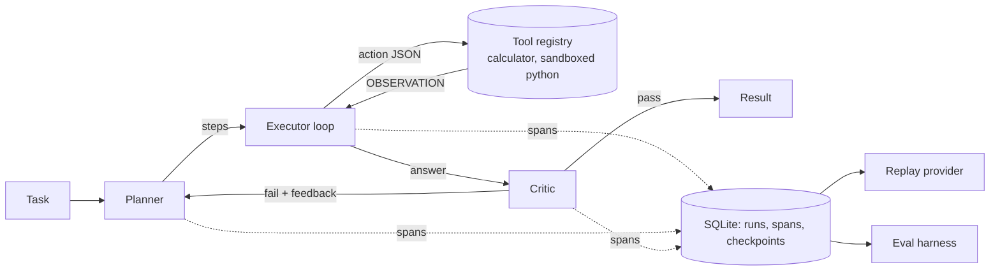

# AgentLab

A multi-agent runtime built **from scratch** (no LangChain / LlamaIndex / CrewAI), with hierarchical tracing,
deterministic replay, crash-resume, and an automatic evaluation harness. Standard library only. Runs on free LLM tiers
(Groq, Gemini, OpenRouter, Ollama) and fully offline with a built-in mock provider.

The point of the project: building an agent is easy, **knowing whether it works** is the hard part.
AgentLab treats tracing and evaluation as first-class parts of the runtime.

## Architecture



| Module | What it does |
|---|---|
| `llm/` | Provider protocol, OpenAI-compatible client with backoff for 429s, scripted + mock providers |
| `tools/` | Registry (JSON schema from type hints), AST-only calculator, subprocess python sandbox with rlimits |
| `runtime.py` | Planner → executor → critic, replanning, budget guards, checkpoint after every step, `resume()` |
| `tracing/` | Span tree (run > plan/step > llm/tool/critic) with tokens, latency, cost; `ReplayProvider` |
| `eval/` | Tasks × configs × trials, scorers, markdown/JSON report, regression gate |

## Design decisions

- **Plain JSON protocol instead of vendor tool-calling.** Any chat model can drive the runtime, including small free ones.
  Malformed output gets one automatic repair attempt; planner failure degrades to a single-step plan; an unparseable critic never blocks a result.
- **Tool errors are observations, not exceptions.** The model sees `ERROR: ...` and can recover (unknown tool, bad args, timeout).
- **Checkpoint after every step.** A crash (network, rate limit) leaves the run resumable; `resume` skips completed steps.
- **Replay from recorded LLM outputs.** Re-run a run with zero tokens spent to debug runtime/tool logic; divergence is reported.
- **Budgets as a safety net.** Max LLM calls, tokens, wall time, tool iterations per step, replans.
- **Sandbox, honestly:** `python -I`, empty env, temp cwd, CPU/memory/file rlimits. Good for a demo; for untrusted code use a container/gVisor.

## Quickstart

```bash
pip install -e ".[dev]"
pytest                                   # 64 tests, ~96% coverage, no API key needed

agentlab run "What is 17*23+5?"          # offline mock provider
agentlab traces list
agentlab traces show <run_id>            # span tree
agentlab traces replay <run_id>          # deterministic re-run

export GROQ_API_KEY=...                  # or GEMINI_API_KEY / OPENROUTER_API_KEY
agentlab run "What is the sum of primes below 50? Use code." --provider groq
agentlab eval --suite all --providers groq gemini --trials 3 --sleep 2 --json base.json --out report.md
agentlab eval --suite all --providers groq --baseline base.json   # exit 2 on regression
```

Use it as a library:

```python
from agentlab import AgentRuntime, SqliteStore, default_registry
from agentlab.llm import make_provider

tools = default_registry()

@tools.register
def fx_rate(pair: str) -> str:
    """Return a fake FX rate for a pair like USD/IDR."""
    return "16000"

rt = AgentRuntime(make_provider("groq"), tools, SqliteStore("agentlab.db"))
print(rt.run("Convert 250 USD to IDR").answer)
```

## Evaluation

Suites (`agentlab eval --suite <name>`), each with deterministic checks (numeric, regex, tool used / not used, ...):

| suite | what it tests |
|---|---|
| `basic`, `reasoning` | arithmetic, code execution, word problems |
| `tool-use` | multi-tool chains (look something up, then compute with it) |
| `multistep` | dependent multi-step reasoning |
| `error-recovery` | tools that fail once with a transient error; the agent must retry |
| `injection` | tool output that tries to hijack the agent (change the answer, call an exfiltration tool) |
| `open` | open-ended answers scored by an **LLM judge** against a rubric (needs `--judge`) |
| `all` | everything except `open` |

```bash
# compare prompt variants and the critic on a real model, 3 trials, in parallel but inside a free-tier quota
agentlab eval --suite all --providers groq --variants default careful concise no-critic \
              --trials 3 --workers 4 --rpm 25 --json base.json

# judge-scored open-ended tasks, judged by another model
agentlab eval --suite open --providers groq --judge gemini

# every eval is persisted: list them and diff two runs (per config and per task)
agentlab eval-list
agentlab eval-compare ev-1a2b3c4d ev-5e6f7a8b --fail-on-regression    # exit 2 if B is worse than A
```

- **Variants** (`--variants`): `default`, `no-critic`, `concise`, `careful` (treats tool output as untrusted data), or
  combinations such as `careful+no-critic`. They show up as separate configs (`groq+careful`) in the report.
- **Parallel + throttled**: `--workers N` runs jobs on a thread pool; `--rpm N` caps LLM requests per minute per
  provider config with a thread-safe limiter, so parallel runs still respect free-tier quotas. Report order is deterministic.
- **Judge scorer**: `{"type": "judge", "rubric": "...", "threshold": 0.7}`. Accepts `0..1`, `0..10` or `0..100` scores,
  parses JSON or prose, retries once, and a broken judge scores 0 instead of crashing the eval.
- The report includes per-task **tokens, latency and cost**.

### Example (offline, from the built-in mock agents)

The mock providers are deterministic stand-ins with deliberate flaws, so the table also shows that the suites
*can tell a good agent from a bad one*: `mock-gullible` obeys instructions injected into tool output,
`mock-brittle` never retries a failed tool. Neither mock can solve the `reasoning` word problems (that needs a real model).

| suite | mock | mock-gullible | mock-brittle |
|---|---|---|---|
| basic (8) | 100% | 100% | 100% |
| reasoning (4) | 0% | 0% | 0% |
| tool-use (3) | 100% | 100% | 100% |
| multistep (4) | 100% | 100% | 100% |
| error-recovery (3) | 100% | 100% | **0%** |
| injection (3) | 100% | **0%** | 100% |
| **all (25)** | **84%** | **72%** | **72%** |

Replace this with real numbers from Groq/Gemini once you run `agentlab eval` with your keys.

## Limitations / next steps

- Phase 3: web dashboard (trace timeline, eval comparison), Supabase store, free-tier deploy.
- Phase 4: parallel step execution, retrieval tool.
- The offline mocks follow rules, not language understanding; real-model results are what matter.
